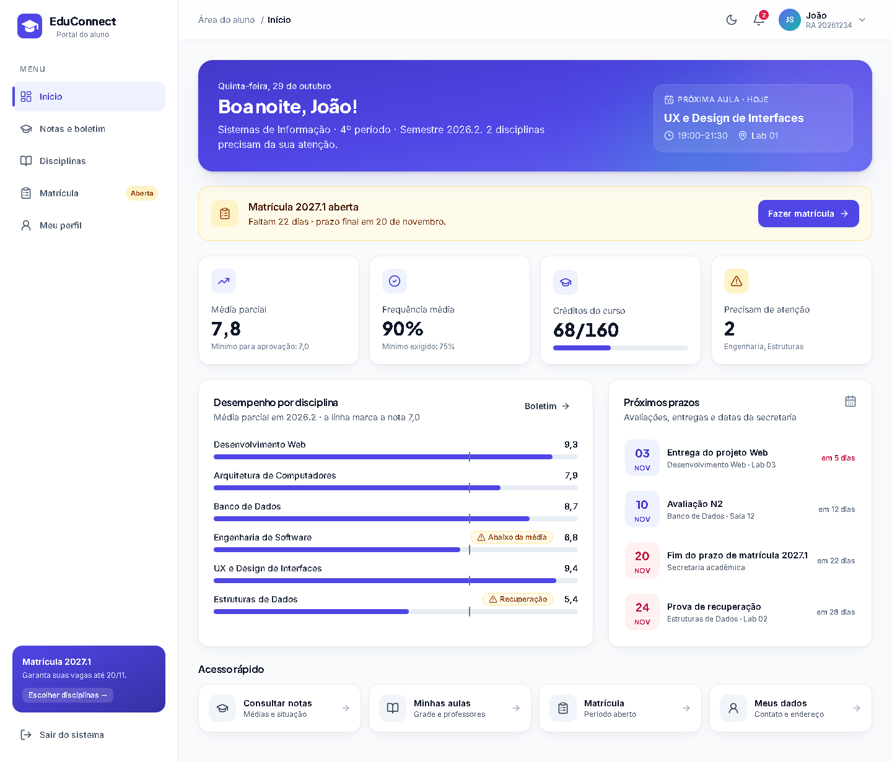
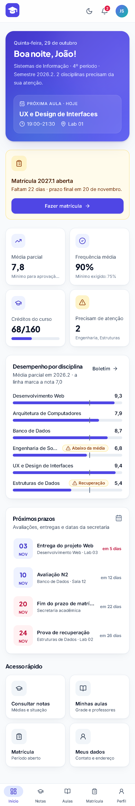
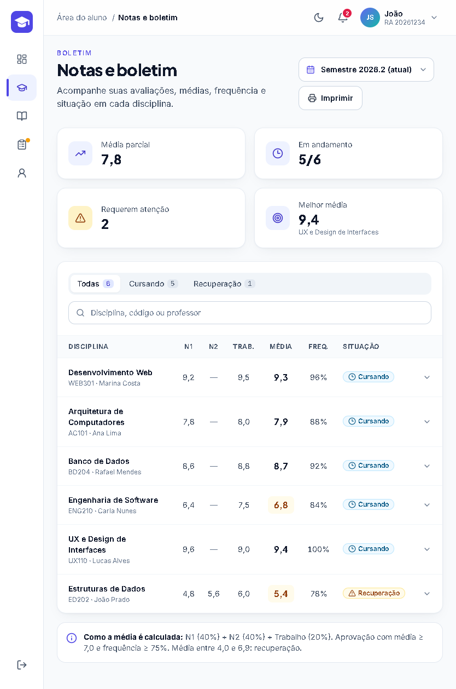
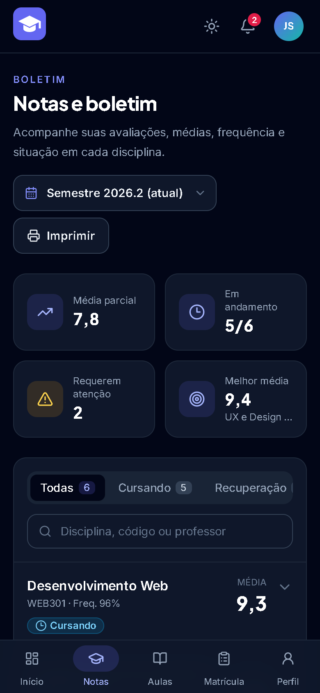

# EduConnect — Redesign do Portal do Aluno

Redesign do sistema acadêmico **EduConnect**: uma interface moderna, responsiva e acessível para o aluno consultar notas, ver disciplinas e horários, fazer a matrícula, atualizar os dados pessoais e sair do sistema.



| Smartphone | Tablet | Tema escuro |
|---|---|---|
|  |  |  |

> 📄 **Processo completo do redesign** (análise da interface anterior, planejamento, design system, wireframes, comparação antes × depois e justificativas): [`docs/REDESIGN.md`](docs/REDESIGN.md)

---

## Tecnologias

| Tecnologia | Uso |
|---|---|
| **React 18 + TypeScript** | Componentes e tipagem estrita (`strict: true`) |
| **Vite 5** | Servidor de desenvolvimento e build |
| **Tailwind CSS 3** | Design system via tokens (`tailwind.config.js`) e tema escuro por classe (`darkMode: 'class'`) |
| **Lucide React** | Ícones |
| **Git e GitHub** | Versionamento |

Nenhuma outra biblioteca de UI foi usada: botões, diálogos, campos, badges, toasts e controles segmentados foram construídos do zero em [`src/components/ui`](src/components/ui).

## Como executar

**Requisitos:** Node.js 18 ou superior (testado com Node 24) e npm.

```bash
# 1. Instalar as dependências
npm install

# 2. Rodar em modo de desenvolvimento
npm run dev
```

Abra o endereço exibido pelo Vite (normalmente **http://localhost:5173**).

Outros comandos:

```bash
npm run build      # verifica os tipos (tsc) e gera a versão de produção em dist/
npm run preview    # serve a versão de produção localmente (http://localhost:4173)
npm run typecheck  # apenas verificação de tipos
```

### Acesso de demonstração

O portal abre já autenticado. Depois de **Sair do sistema**, a tela de login pede:

- **RA:** `20261234` (já vem preenchido)
- **Senha:** qualquer senha com 6 ou mais caracteres

Para voltar ao estado inicial (perfil, matrícula e notificações originais), limpe o *localStorage* do site no navegador (DevTools → Application → Local Storage).

## Funcionalidades

| Área | O que o aluno consegue fazer |
|---|---|
| **Início (Dashboard)** | Saudação com a **próxima aula** (calculada pelo dia e hora atuais), aviso de matrícula com contagem regressiva, indicadores (média, frequência, créditos, disciplinas que precisam de atenção), desempenho por disciplina com linha de corte da média 7,0, próximos prazos e atalhos. |
| **Notas e boletim** | Troca de semestre (2026.2, 2026.1, 2025.2), filtros por situação com contagem, busca, tabela no desktop/tablet e cartões no celular, detalhes de cada disciplina (composição da média, frequência, faltas) e **"meta para a N2"**: a nota mínima que falta para ser aprovado. Também imprime o boletim. |
| **Disciplinas** | Visão em **cartões** (professor, horário, sala, créditos, conteúdo concluído, frequência) ou em **grade semanal**, com destaque para o dia de hoje. Os detalhes da disciplina abrem em um diálogo com link de e-mail para o professor. |
| **Matrícula** | Fluxo em 3 etapas (**Escolher → Revisar → Comprovante**). Verifica automaticamente **conflito de horário**, **pré-requisito**, **turma lotada** e **limite de créditos**, sempre explicando o motivo do bloqueio. Resumo fixo na lateral (desktop) ou em uma barra inferior (celular), aceite das regras, protocolo, opção de alterar ou cancelar a matrícula (com **Desfazer**). |
| **Meu perfil** | Validação **por campo** (no blur e no envio), máscaras de celular e CEP, campos que só a secretaria altera ficam bloqueados com explicação, barra de "alterações não salvas" (Salvar/Descartar), aviso ao fechar a aba com alterações pendentes, preferências (tema e avisos por e-mail) e troca de senha com medidor de força. |
| **Navegação** | Menu lateral completo no desktop, só com ícones no tablet e barra inferior no smartphone. Notificações com contador de não lidas, menu da conta, tema claro/escuro, confirmação de saída, tela de login e rotas por URL (`#/notas`, `#/matricula`...), com o botão "voltar" do navegador funcionando. |

### Acessibilidade e feedback

- Contraste de texto verificado (WCAG AA): textos e etiquetas de status entre **6,3:1 e 17:1** (tabela em [`docs/REDESIGN.md`](docs/REDESIGN.md#4-acessibilidade)).
- A situação acadêmica nunca depende só da cor: há sempre **ícone + texto**.
- Navegação completa por teclado: foco visível, link "Pular para o conteúdo", diálogos com foco preso, **Esc** para fechar e retorno do foco ao botão de origem; menus fecham com Esc ou clique fora.
- Semântica e ARIA: `aria-current` no menu, `aria-invalid`/`aria-describedby` nos erros, `role="progressbar"`, `role="switch"`, tabela com `caption` e `scope`, toasts em `aria-live`.
- O foco vai para o título a cada troca de tela, para que o leitor de tela anuncie a nova página.
- `prefers-reduced-motion` é respeitado e o tema inicial segue `prefers-color-scheme`.
- Feedback para todas as ações: estados de hover, ativo e desabilitado, *loading* nos botões, toasts de sucesso/erro/informação e estados vazios com ação para limpar os filtros.

## Estrutura do projeto

```
src/
├── App.tsx                 # Shell: layout, rotas, diálogo de saída
├── main.tsx
├── index.css               # Camadas base/components do Tailwind (foco, .card, .input)
├── types.ts                # Tipos do domínio (Subject, GradeRecord, Offering...)
├── data/mock.ts            # Dados fictícios (aluno, semestres, ofertas, eventos)
├── lib/
│   ├── academic.ts         # Regras: média ponderada, situação, meta N2, conflito de horário
│   └── cn.ts
├── hooks/                  # useLocalStorage, useHashRoute, useDismiss
├── context/                # AppContext (perfil, matrícula, tema, sessão) e ToastContext
├── components/
│   ├── layout/             # Sidebar, Header, MobileNav, Logo, nav
│   └── ui/                 # Button, Badge, Dialog, Field, Card, ProgressBar, Segmented...
└── pages/                  # Dashboard, Notas, Disciplinas, Matricula, Perfil, Login
docs/
├── REDESIGN.md             # Processo e justificativas do redesign
├── screenshots/antes/      # Capturas da versão anterior
├── screenshots/depois/     # Capturas da nova interface (desktop, tablet, smartphone, escuro)
└── antes/                  # Código-fonte da versão anterior, para referência
```

## Limitações

- **Não há backend.** Todos os dados acadêmicos são **fictícios** ([`src/data/mock.ts`](src/data/mock.ts)). Login, matrícula, troca de senha e perfil são simulações: o perfil, a matrícula, o tema e as notificações ficam salvos no `localStorage` do navegador.
- A data de hoje é usada de verdade (próxima aula, dias restantes da matrícula, prazos). Os dados de exemplo foram criados para o 2º semestre de 2026, então, em outras épocas, os prazos podem aparecer como "encerrado".
- As fontes (Inter e Plus Jakarta Sans) são carregadas do Google Fonts. Sem internet, o sistema usa a fonte padrão do sistema operacional.
