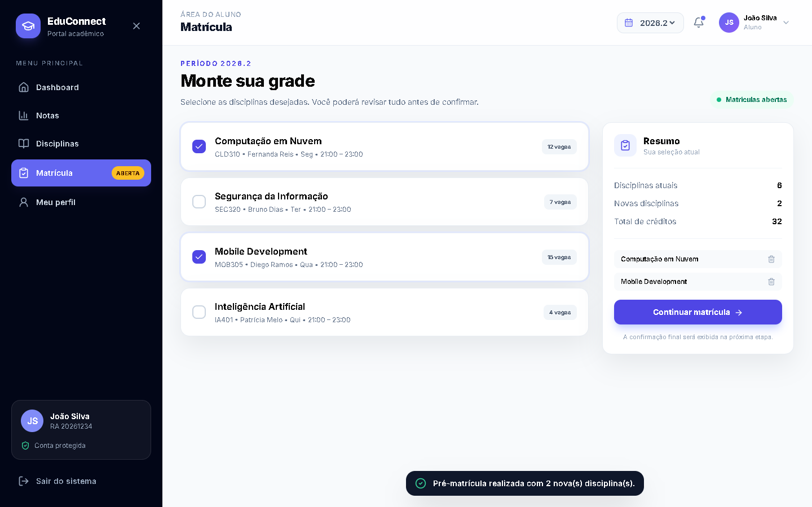
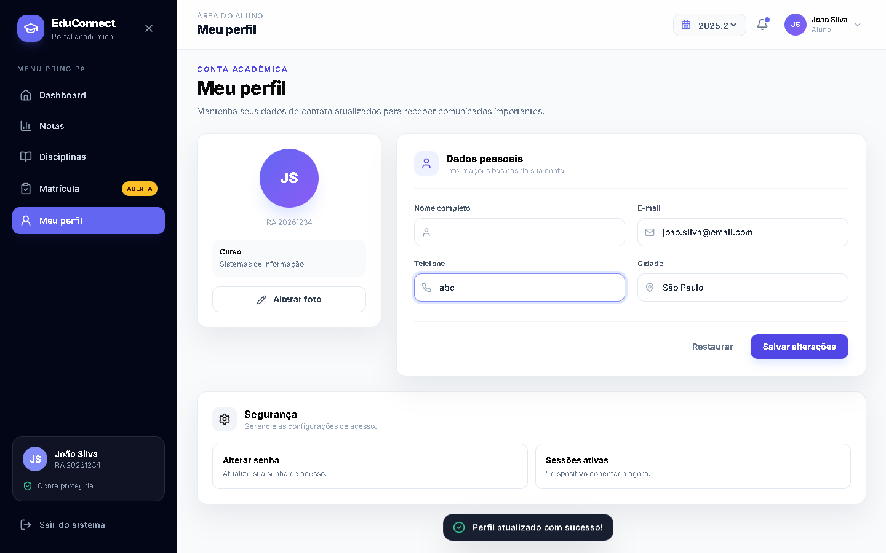
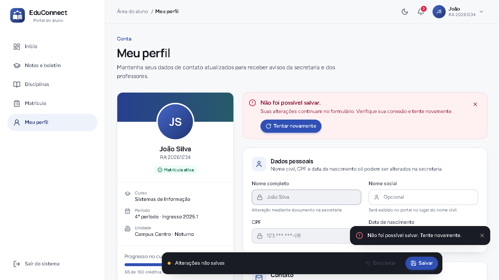
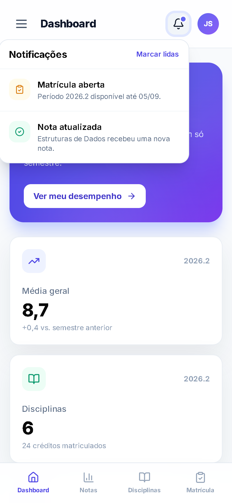
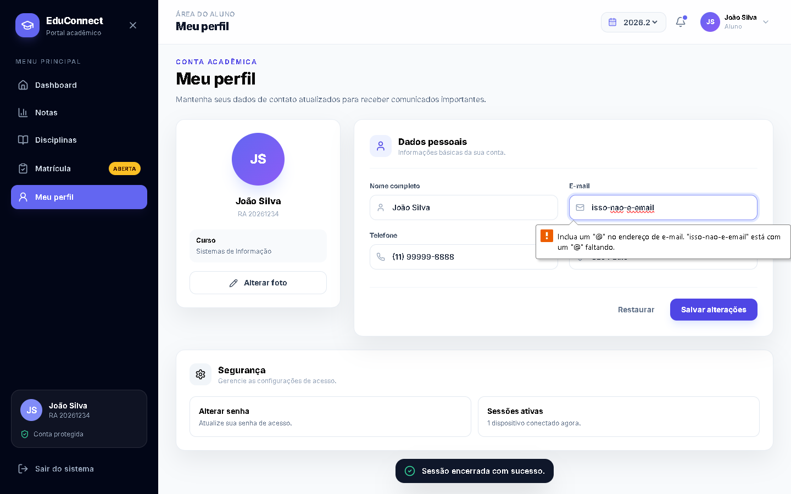

# Redesign do EduConnect: processo e decisões

Este documento registra as cinco etapas da atividade: análise da interface anterior, planejamento, desenvolvimento, responsividade e interações, e comparação entre o antes e o depois.

> **Sobre o "antes":** o "antes" é o **projeto original fornecido pelo professor**. As capturas em [`screenshots/antes/`](screenshots/antes) foram geradas rodando esse projeto sem nenhuma alteração, e o código dele está em [`antes/`](antes). Antes do redesign existiu também uma versão intermediária, com tema escuro e confirmações adicionados ao original. Ela fica registrada em [`versao-intermediaria/`](versao-intermediaria), mas não é usada na comparação.

---

## Etapa 1: análise da interface original

A análise combinou leitura do código com testes automatizados no navegador (Chrome), nas larguras de 360, 390, 768, 1024 e 1440 px. Cada problema abaixo foi **reproduzido**, não apenas deduzido do código.

### Problemas encontrados

| # | Área | Problema (verificado) | Impacto para o aluno |
|---|---|---|---|
| 1 | Técnico | Em uma instalação limpa, `npm run build` **falha com 522 erros de TypeScript**: o `package.json` não declara `@types/react` e `@types/react-dom`. Todo o sistema fica em um único `App.tsx` de 441 linhas | Não é possível gerar a versão de produção; manutenção difícil e componentes repetidos |
| 2 | Feedback falso: sair | "Sair do sistema" só mostra o toast "Sessão encerrada com sucesso." O aluno **continua logado** e vendo o menu e os dados | A mensagem afirma algo que não aconteceu; em um computador compartilhado, o aluno acha que saiu |
| 3 | Feedback falso: matrícula | A tela promete "Você poderá revisar tudo antes de confirmar" e "A confirmação final será exibida na próxima etapa", mas "Continuar matrícula" **finaliza na hora** com "Pré-matrícula realizada com 2 nova(s) disciplina(s)." Não há revisão nem comprovante | O aluno não confere a escolha e não tem como provar que se matriculou |
| 4 | Feedback falso: perfil | Salvar com **nome vazio e telefone "abc"** mostra "Perfil atualizado com sucesso!". Ao recarregar, as alterações somem. "Alterar foto" só exibe "Seletor de foto aberto." | Dados inválidos são aceitos e o aluno acha que salvou algo que se perdeu |
| 5 | Informação | Indicadores fixos no código (média 8,7, "6 disciplinas · 24 créditos", frequência 94%). Notas "Aprovado" em um semestre em andamento. O seletor de semestre **não altera nada**: em 2025.2, o Dashboard e as Notas mostram exatamente o mesmo conteúdo | O aluno não pode confiar nos números nem consultar semestres anteriores |
| 6 | Notas | Só a nota final de cada disciplina: sem N1/N2/trabalho, sem frequência, sem busca e sem explicar o cálculo da média | A pergunta mais comum ("quanto preciso tirar?") fica sem resposta |
| 7 | Disciplinas | Não há grade semanal. O "⋯" de cada cartão parece um botão, mas é decorativo | Difícil planejar a semana; elemento que parece clicável e não faz nada |
| 8 | Matrícula | Não verifica conflito de horário, pré-requisito, vagas ou limite de créditos. A soma de créditos começa em 24 fixos | Seria possível montar uma grade impossível |
| 9 | Navegação (celular) | A barra inferior tem só 4 itens (**sem Perfil e sem Sair**), além de um menu lateral duplicado. O painel de notificações tem largura fixa de 320 px e **sai pela esquerda da tela** em 390 px. Esc não fecha o painel e "Marcar lidas" apenas o fecha. No desktop, o botão "X" de fechar o menu lateral aparece sem função | Perfil e saída escondidos no celular; controles quebrados ou inúteis |
| 10 | Acessibilidade | **13 textos** só no Dashboard usam `slate-400` sobre branco (**2,56:1**, abaixo do mínimo de 4,5:1). Os toasts não são anunciados (sem `aria-live`). Não há `aria-current` no menu nem link para pular ao conteúdo | Leitura difícil para baixa visão; leitor de tela não informa o resultado das ações |
| 11 | Visual | O CSS define o fundo da página como **vermelho** (`#f32105`), coberto pelo conteúdo, mas visível na rolagem elástica do celular. A barra de rolagem azul (`#046ff1`) fica fora da paleta índigo. Não há tema escuro | Identidade visual inconsistente |
| 12 | Navegação | Não há rotas: atualizar a página sempre volta ao Dashboard e o botão "voltar" sai do sistema | Comportamento diferente do esperado na web |

### Tabela da atividade: 5 problemas principais

Resumo no formato pedido pela atividade (Etapa 1), com os problemas de maior impacto da lista acima:

| Problema encontrado | Por que é um problema? | Solução proposta |
|---|---|---|
| 1. **Feedback falso no Perfil:** salvar com nome vazio e telefone "abc" mostra "Perfil atualizado com sucesso!", e os dados somem ao recarregar | Mensagem de erro inadequada: o aluno acredita que os dados foram salvos e deixa de receber avisos da secretaria | Validação por campo (no blur e no envio) com mensagem específica abaixo do campo; botão **Salvar** com estado de carregamento; toast de sucesso só depois de salvar de verdade; aviso fixo com **Tentar novamente** quando o salvamento falha |
| 2. **Feedback falso ao sair:** "Sair do sistema" mostra "Sessão encerrada com sucesso", mas o aluno continua logado | Ausência de feedback real: em um computador compartilhado, outra pessoa acessa os dados do aluno | Diálogo de confirmação, botão com carregamento ("Saindo...") e saída real para a tela de login |
| 3. **Ação importante sem revisão na matrícula:** "Continuar matrícula" finaliza na hora, sem verificar conflito de horário, pré-requisito ou vagas | Ação importante pouco controlada: é possível montar uma grade impossível sem perceber | Fluxo em 3 etapas (Escolher → Revisar → Comprovante), bloqueios sempre explicados, resumo de créditos fixo e diálogo de confirmação para cancelar |
| 4. **Layout quebrando no celular:** o painel de notificações sai da tela em 390 px e a barra inferior não tem Perfil nem Sair | Funções essenciais ficam inacessíveis justamente no dispositivo mais usado pelos alunos | Navegação adaptada a cada largura (barra inferior com 5 itens, menu só com ícones no tablet, menu completo no desktop) e painéis com largura fluida; testado em 360, 768 e 1366 px |
| 5. **Baixo contraste e sem acessibilidade:** 13 textos com contraste 2,56:1, sem foco visível nem anúncio das mensagens | Alunos com baixa visão ou que usam teclado e leitor de tela não conseguem usar o portal | Tokens de cor com contraste mínimo de 4,96:1, foco visível em todos os controles, toasts com `aria-live` e navegação completa por teclado |
| 6. **Cores sem padrão e sem tema escuro:** fundo vermelho aparecendo na rolagem, barra de rolagem azul fora da paleta | Interface pouco profissional e inconsistente, o oposto do que o cliente pediu | Design system com tokens centralizados em `tailwind.config.js` e modo claro/escuro com as cores vindas do tema |

**Ponto positivo do original:** layout em cartões, paleta índigo e ícones Lucide já davam uma boa base. O redesign manteve a ideia, mas corrigiu o comportamento, a hierarquia e a consistência.

---

## Etapa 2: planejamento

### Princípios

1. **Responder às perguntas do aluno**, não só exibir dados: "Qual é a minha próxima aula?", "Quanto preciso tirar na N2?", "Essa disciplina choca com outra?"
2. **Explicar cada bloqueio**: nenhum botão ou opção fica desabilitado sem dizer o motivo.
3. **Uma fonte de verdade**: indicadores calculados a partir dos dados (média ponderada por crédito, situação, créditos), nunca fixos no código.
4. **Mobile first**: cada tela foi pensada primeiro para 360 px.

### Design system

**Conceito visual: sóbrio e profissional.** O cliente pediu uma aplicação "mais profissional e consistente". Por isso o portal usa uma única cor de marca (azul acadêmico) para ações e navegação, cinzas neutros para todo o resto e as cores de status só quando há algo a comunicar. O destaque visual fica por conta de uma **fotografia de biblioteca** gerada no Artlist (modelo Nano Banana 2), usada no painel de boas-vindas e na tela de login com uma película escura que garante a leitura do texto. A navegação segue o padrão de gaveta do Material Design: superfície clara e item ativo em uma pílula azul suave.

**Cores** (definidas como tokens em [`tailwind.config.js`](../tailwind.config.js)):

| Papel | Token | Hex | Uso |
|---|---|---|---|
| Marca | `brand-600` | `#2f50b4` | Azul acadêmico: ações primárias, links, barras de progresso |
| Marca (suave) | `brand-50` / `brand-100` | `#eef2fb` / `#dce4f7` | Item ativo do menu, ícones e botões suaves |
| Marca (escuro) | `brand-300/400` | `#8fa8e3` / `#6684d6` | Texto e destaques no tema escuro |
| Apoio | `accent-700` | `#285b69` | Azul-petróleo discreto, só no gradiente da capa do perfil |
| Neutros | `slate-50 … 950` | `#f7f8fa` … `#0f1117` | Cinzas frios: fundo, superfícies, textos e bordas |
| Status: aprovado | `emerald` | — | Sempre com ícone ✓ e o texto "Aprovado" |
| Status: atenção | `amber` | — | Recuperação, abaixo da média, últimas vagas, prazos |
| Status: reprovado/erro | `rose` | — | Reprovação, erro de validação, sair |
| Status: em andamento | `sky` | — | "Cursando" |

As cores de status são **reservadas**: não aparecem como decoração, então cada uma tem sempre o mesmo significado.

**Tipografia**: *Manrope* (600–800), geométrica e firme, nos títulos e números de destaque; *Figtree* (400–700) nos textos de interface, pela boa leitura em tamanhos pequenos. Os números usam `tabular-nums`, para que as notas fiquem alinhadas na tabela. Os rótulos usam letras normais, sem caixa-alta.

| Nível | Fonte / tamanho / peso |
|---|---|
| Saudação do Início | Manrope · 30–36 px · 800 |
| Título da página | Manrope · 24–32 px · 700 |
| Título de cartão | Manrope · 16 px · 700 |
| Corpo | Figtree · 14–16 px · 400 |
| Rótulo / legenda | Figtree · 12–14 px · 500–600 |

**Forma e espaço**: espaçamento em múltiplos de 4 px; botões e itens de menu em formato de pílula (padrão Material 3); cantos de 12 px nos campos, 16 px nos cartões e 24 px no painel de boas-vindas; duas sombras neutras e suaves (`card` e `raised`); áreas de toque de pelo menos 40 px no desktop e 48 px no celular.

**Componentes** ([`src/components/ui`](../src/components/ui)): `Button` (primary, secondary, ghost, subtle, danger; tamanhos sm/md/lg; estado de *loading*), `IconButton` (com contador), `Badge` e `SituationBadge`, `Field` (rótulo, dica, erro e ícone), `Dialog`, `Card`, `PageHeader`, `ProgressBar` (com marcador de meta), `Segmented`, `SearchInput`, `EmptyState`, `Avatar` e `Toast`.

### Wireframes (estrutura das telas)

```
DESKTOP (≥1024 px)                                SMARTPHONE (<768 px)
┌──────────┬─────────────────────────────────┐    ┌────────────────────┐
│ ▣ Logo   │ Área do aluno / Início   ☾ 🔔 JS│    │ ▣          ☾ 🔔 JS │
│          ├─────────────────────────────────┤    ├────────────────────┤
│ ▸ Início │ ┌───────────────────┬─────────┐ │    │ Boa noite, João!   │
│   Notas  │ │ Boa noite, João!  │ Próxima │ │    │ ┌────────────────┐ │
│   Discip.│ │ resumo do período │  aula   │ │    │ │ Próxima aula   │ │
│   Matríc.│ └───────────────────┴─────────┘ │    │ └────────────────┘ │
│   Perfil │ [!] Matrícula aberta  [Fazer →] │    │ [!] Matrícula      │
│          │ [Média][Freq.][Créd.][Atenção]  │    │ [Média ][Freq.  ]  │
│          │ ┌Desempenho────────┐┌Prazos──┐  │    │ [Créd. ][Atenção]  │
│ [Matríc. │ │ ████████│░░ 9,3  ││03 NOV  │  │    │ Desempenho...      │
│  2027.1] │ │ ██████  │░░ 6,8  ││10 NOV  │  │    │ Prazos...          │
│ ⎋ Sair   │ └──────────────────┘└────────┘  │    ├────────────────────┤
└──────────┴─────────────────────────────────┘    │ ⌂   🎓   📖  📋  👤 │
TABLET (768–1023 px): menu lateral só com ícones   └────────────────────┘

MATRÍCULA: etapas  ① Escolher ─── ② Revisar ─── ③ Comprovante
┌ Busca  [Todos|Seg|Ter|...] ─────────────┐ ┌ Resumo ───────────┐
│ ☑ Computação em Nuvem            4 cr   │ │ Créditos  15/24   │
│ 🔒 Desenv. Mobile                4 cr   │ │ ███████│░░░░░     │
│    ⚠ Conflito de horário com C. Nuvem   │ │ • C. Nuvem    🗑  │
│ ☐ Gestão de Projetos             3 cr   │ │ [Revisar →]       │
└─────────────────────────────────────────┘ └───────────────────┘
No celular, o resumo vira uma barra fixa acima da navegação inferior.
```

---

## Etapa 3: desenvolvimento

- **Arquitetura**: o arquivo único foi dividido em `pages/`, `components/layout`, `components/ui`, `context/`, `hooks/` e `lib/`. As regras acadêmicas ficam em [`lib/academic.ts`](../src/lib/academic.ts) (média ponderada N1 40% · N2 40% · Trabalho 20%, situação, meta para a N2, sobreposição de horários).
- **Estado global** em `AppContext` (perfil, matrícula, notificações, tema, sessão), persistido com o hook `useLocalStorage`.
- **Rotas por hash** (`useHashRoute`): cada tela tem URL própria, o botão "voltar" funciona e o título da aba muda junto.
- **Tema escuro** feito com variantes `dark:` em cada componente, sem `!important`, e aplicado antes da renderização para evitar o "piscar" do tema errado.
- **Build e tipos**: `npm run build` (com `tsc` em modo `strict`) passa sem erros.

---

## Etapa 4: responsividade e interações

### Pontos de quebra

| Largura | Navegação | Conteúdo |
|---|---|---|
| < 768 px (smartphone) | Barra inferior com 5 itens e logo + ações no cabeçalho | 1–2 colunas; notas em cartões expansíveis; diálogos sobem de baixo (*bottom sheet*); barras fixas de ação |
| 768–1023 px (tablet) | Menu lateral só com ícones (80 px) | 2 colunas; notas em tabela |
| ≥ 1024 px (desktop) | Menu lateral completo (288 px) com chamada para a matrícula | 3–4 colunas; resumo da matrícula fixo na lateral |

Verificação automatizada: nenhuma tela tem rolagem horizontal em **360, 390, 768, 1024 e 1440 px**, e o console do navegador não registra erros.

### Microinterações e feedback

| Ação | Feedback |
|---|---|
| Trocar de tela | Conteúdo entra com *fade + slide* (400 ms); foco vai para o título |
| Passar o mouse em cartões e atalhos | Elevação (`-translate-y-0.5`) e sombra; a seta do atalho desliza |
| Pressionar botão | Leve redução de escala (`active:scale-[.98]`) |
| Barras de progresso | Crescem a partir da esquerda ao aparecer |
| Selecionar disciplina | A caixa de seleção aumenta e o cartão ganha borda e fundo da cor da marca; o resumo e a barra de créditos atualizam em tempo real |
| Opção bloqueada | Cadeado, opacidade reduzida e motivo por escrito (conflito, pré-requisito, lotada, limite) |
| Enviar formulário / confirmar | Botão com *spinner* e texto "Salvando..." / "Confirmando...", desabilitado para evitar clique duplo |
| Sucesso, erro ou informação | Toast com ícone; o cancelamento da matrícula oferece **Desfazer** |
| Erro de campo | Borda vermelha, ícone e mensagem abaixo do campo; o foco vai para o primeiro campo inválido |
| Alterar dados do perfil | Barra flutuante "Alterações não salvas" com Descartar/Salvar |
| Confirmar matrícula | Etapas ficam verdes, ícone de sucesso aparece com animação e o protocolo é exibido |
| Sistema com "reduzir movimento" ativo | Todas as animações são praticamente desativadas |

---

## Etapa 5: comparação antes e depois

### Dashboard

| Antes | Depois |
|---|---|
|  |  |

**O que mudou:** a mensagem genérica ("Você está indo muito bem") deu lugar à **próxima aula** real e ao número de disciplinas que precisam de atenção. Os indicadores agora são calculados e clicáveis, e o "Resumo das notas", que repetia a tela de Notas, virou um **gráfico de desempenho** com a linha de corte 7,0. Com isso, o aluno identifica de imediato onde está em risco. A matrícula aparece como aviso contextual com contagem regressiva e some depois de confirmada.

### Notas

| Antes | Depois |
|---|---|
|  |  |

**O que mudou:** a tabela mostra N1, N2, trabalho, média, frequência e situação (com ícone). Os filtros exibem contagens e o seletor de semestre **carrega dados reais** de outro período. O detalhe expansível mostra a composição da média e a **meta para a N2**, e a regra de cálculo fica explicada no rodapé.

### Disciplinas

| Antes | Depois: cartões | Depois: grade semanal |
|---|---|---|
|  |  |  |

**O que mudou:** a nova **grade semanal** destaca o dia de hoje e os cartões mostram "Aula hoje". O ícone "⋯", que não fazia nada, deu lugar a um botão "Ver detalhes" que funciona, com contato do professor. A frequência baixa aparece destacada.

### Matrícula

| Antes: seleção | Antes: "Continuar" já finaliza | Depois: escolha | Depois: revisão | Depois: comprovante |
|---|---|---|---|---|
|  |  |  |  |  |

**O que mudou:** no original, a tela prometia uma revisão que não existia: "Continuar matrícula" finalizava na hora, só com um toast. Agora o processo virou um passo a passo com indicador de etapas. O sistema **impede grades impossíveis** (conflito, pré-requisito, lotação, limite de créditos) e explica cada bloqueio. A revisão mostra a semana resultante e pede o aceite das regras. O comprovante tem protocolo e permite alterar ou cancelar, com Desfazer.

### Perfil

| Antes | Antes: nome vazio e telefone "abc" salvos "com sucesso" | Depois: erro no campo certo |
|---|---|---|
|  |  |  |

| Depois: falha ao salvar (Desafio B) |
|---|
|  |

**O que mudou:** o original aceitava qualquer valor, dizia "Perfil atualizado com sucesso!" e perdia tudo ao recarregar. Agora as alterações são validadas e ficam salvas. Os dados estão agrupados em seções (pessoais, contato, endereço, segurança). Os campos que só a secretaria altera ficam bloqueados com explicação e há suporte a **nome social**. Os erros aparecem por campo e o celular e o CEP têm máscara. A barra de alterações não salvas evita perder edições.

### Smartphone

| Antes: Dashboard | Antes: notificações saindo da tela | Depois: Dashboard | Depois: Notas | Depois: Matrícula |
|---|---|---|---|---|
|  |  |  |  |  |

**O que mudou:** a barra inferior agora tem os **5 destinos**, incluindo Perfil, e indica o item ativo. O menu lateral duplicado foi removido. O painel de notificações ocupa a largura da tela no celular, em vez de sair pela borda. As notas viram cartões expansíveis e a matrícula tem um resumo fixo com o botão "Revisar" sempre ao alcance do polegar.

### Navegação e saída

| Antes: "Sair" (continua logado) | Depois: confirmação | Depois: login | Depois: notificações (celular) | Depois: tema escuro |
|---|---|---|---|---|
|  |  |  |  |  |

**O que mudou:** no original, "Sair" mostrava "Sessão encerrada com sucesso." com o aluno ainda logado. Agora sair pede confirmação clara ("Continuar conectado" / "Sair") e leva a uma **tela de login** real. As notificações têm contador, marcam como lidas ao abrir e levam à tela relacionada. O tema escuro foi desenhado como paleta própria, e não como inversão das cores.

---

## 4. Acessibilidade

Contraste medido com a fórmula WCAG 2.1 (mínimo AA: 4,5:1 para texto normal):

| Combinação | Contraste | Uso |
|---|---|---|
| `slate-400` sobre branco (**original**) | 2,56:1 ❌ | 13 textos auxiliares só no Dashboard original |
| `slate-500` sobre branco | 4,96:1 ✅ | Legendas e textos auxiliares (novo mínimo) |
| `slate-600` sobre branco | 7,46:1 ✅ | Descrições |
| `slate-900` sobre `slate-50` | 16,03:1 ✅ | Texto principal |
| Branco sobre `brand-600` | 7,17:1 ✅ | Botão primário e selo "Aberta" |
| `brand-800` sobre `brand-100` | 9,03:1 ✅ | Item ativo da barra inferior (celular) |
| `brand-700` sobre `brand-50` | 8,54:1 ✅ | Item ativo do menu, badges e botões suaves |
| `emerald-800` / `amber-800` / `rose-800` / `sky-800` sobre o fundo `-50` | 6,84–7,30:1 ✅ | Etiquetas de situação |
| Texto branco sobre a foto | película escura de 60–90% | Painel de boas-vindas e login: a foto nunca fica atrás do texto sem a película |
| `slate-100` sobre `slate-950` | 16,69:1 ✅ | Texto no tema escuro |
| `slate-400` sobre `slate-900` | 6,48:1 ✅ | Textos auxiliares no tema escuro |
| `brand-300` sobre `slate-900` | 7,20:1 ✅ | Links e item ativo no tema escuro |

Outras medidas: foco visível em todos os elementos interativos, link "Pular para o conteúdo", diálogos com foco preso, Esc e retorno de foco, `aria-current`, `aria-invalid` + `aria-describedby`, `role="progressbar"` e `role="switch"`, tabela com `caption`/`scope`, toasts anunciados (`aria-live`), status sempre com ícone + texto, `prefers-reduced-motion` e `lang="pt-BR"`.

---

## 5. Principais decisões de design (resumo)

1. **Indicadores que respondem perguntas** (próxima aula, meta para a N2, dias até o fim da matrícula), porque o aluno entra no portal para resolver algo, e não para olhar números soltos.
2. **Navegação adaptada a cada dispositivo** (barra inferior, menu só com ícones, menu completo), sem duplicar menus. A barra inferior fica na zona do polegar e cobre todas as áreas.
3. **Bloqueios sempre explicados** na matrícula e no perfil. Um botão desabilitado sem explicação gera chamados à secretaria.
4. **Cores com significado fixo**: o azul indica ação e navegação, os cinzas organizam o conteúdo, e as cores de status nunca são usadas como enfeite. Assim, verde, âmbar e vermelho sempre querem dizer a mesma coisa.
5. **Fluxo em etapas com revisão e comprovante** na matrícula, porque é uma ação importante e difícil de desfazer: o aluno precisa conferir antes e ter um protocolo depois.
6. **Componentes próprios e tokens centralizados**: qualquer ajuste de cor, raio ou sombra vale para o sistema inteiro, o que garante a consistência pedida no enunciado.

---

## 6. Requisitos da atividade (Material Design)

### Componentes Material e seus equivalentes no projeto

O projeto não usa a biblioteca MUI: os componentes foram construídos com React + Tailwind seguindo os mesmos padrões de comportamento do Material Design. A tabela mostra o equivalente de cada componente e por que ele resolve um problema de experiência do usuário.

| Componente Material | Componente no projeto | Por que é adequado (experiência do usuário) |
|---|---|---|
| **Button** | `Button` ([Button.tsx](../src/components/ui/Button.tsx)): variantes primária, secundária, fantasma e perigo | Uma única ação primária por área deixa claro "o que fazer agora". A variante de perigo (vermelha) avisa antes de ações destrutivas, como sair ou cancelar a matrícula |
| **CircularProgress** | Propriedade `loading` do `Button` | O botão fica desabilitado e mostra um indicador girando enquanto a operação acontece. O aluno sabe que o clique funcionou e não clica duas vezes (evita salvar ou matricular em dobro) |
| **TextField** | `Field` ([Field.tsx](../src/components/ui/Field.tsx)) | Rótulo sempre visível, dica de preenchimento e erro no próprio campo, ligado por `aria-describedby`. O aluno sabe exatamente qual campo corrigir e como |
| **Snackbar** | Toast ([ToastContext.tsx](../src/context/ToastContext.tsx)) | Confirma ações rápidas ("Dados atualizados com sucesso!") sem interromper a tarefa e some sozinho; é anunciado pelo leitor de tela (`aria-live`) |
| **Alert** | `Alert` ([Misc.tsx](../src/components/ui/Misc.tsx)) e avisos de matrícula | Para erros que exigem ação, o aviso fica fixo até ser resolvido (o toast poderia sumir antes de ser lido) e oferece a saída: **Tentar novamente** |
| **Dialog** | `Dialog` ([Dialog.tsx](../src/components/ui/Dialog.tsx)) | Interrompe só quando é preciso confirmar algo importante (sair, cancelar matrícula, trocar senha); prende o foco, fecha com Esc e devolve o foco ao botão de origem |
| **Card** | Classe `card` e `Card` | Agrupa informações relacionadas (um cartão por disciplina, por seção do formulário), o que facilita a leitura rápida |
| **AppBar** | `Header` + `Sidebar` + `MobileNav` | A navegação muda de forma conforme a tela (menu lateral, trilho de ícones, barra inferior na zona do polegar), mas mantém os mesmos destinos |
| **Avatar** | `Avatar` | Iniciais do aluno identificam de quem é a conta aberta, algo importante em computadores compartilhados |
| **Chip** | `Badge` e filtros `Segmented` | Situação acadêmica sempre com ícone + texto (nunca só cor) e filtros com contagem, que mostram o resultado antes do clique |
| **Switch** | `Switch` (Perfil) | Liga e desliga preferências (tema escuro, avisos por e-mail) com efeito imediato e estado visível |

### Requisitos obrigatórios

| Requisito | Onde ver |
|---|---|
| 1. Componentes Material | Tabela acima |
| 2. Hierarquia visual | Título da página (Manrope 24–32 px) → títulos de cartão (16 px, negrito) → texto (14–16 px) → informações secundárias (12–14 px, cor mais clara); uma ação primária por área |
| 3. Feedback | Toda ação mostra resposta: "Dados atualizados com sucesso!", "Senha alterada com sucesso!", "Alterações descartadas.", matrícula confirmada com protocolo, erros por campo |
| 4. Loading | Salvar perfil (1,2 s), entrar, sair, trocar senha e confirmar matrícula: botão desabilitado + indicador girando + texto "Salvando...", "Entrando..." |
| 5. Responsividade | Capturas em 1366 × 768 (desktop), 768 × 1024 (tablet) e 360 × 800 (smartphone), sem rolagem horizontal nem texto cortado |
| 6. Dark Mode | Botão de lua/sol no topo e opção no Perfil; todas as cores vêm dos tokens do tema (`tailwind.config.js`), nenhuma cor fixa espalhada nas telas |

### Desafios surpresa

| Desafio | Implementação |
|---|---|
| A. Empty State | Notas, Disciplinas e Matrícula mostram ícone, explicação e um botão para limpar os filtros quando a busca não encontra nada |
| B. Tratamento de erro | Perfil → cartão **Demonstração** → ligar "Simular falha ao salvar". Ao salvar, o botão mostra o carregamento e depois aparece o aviso "Não foi possível salvar." com **Tentar novamente**, sem perder o que foi digitado |
| C. Confirmação de exclusão | Cancelar a matrícula abre um diálogo de confirmação com botão vermelho; depois de cancelar, o toast oferece **Desfazer**. Sair do sistema também pede confirmação |

### Teste de acessibilidade (teclado)

Com TAB, SHIFT + TAB, ENTER e ESPAÇO é possível fazer todas as tarefas: o primeiro TAB mostra "Pular para o conteúdo"; o foco é sempre visível (anel azul); todos os campos têm rótulo; os botões só com ícone têm nome (`aria-label`, como "Notificações (2 não lidas)"); diálogos e menus fecham com Esc.

